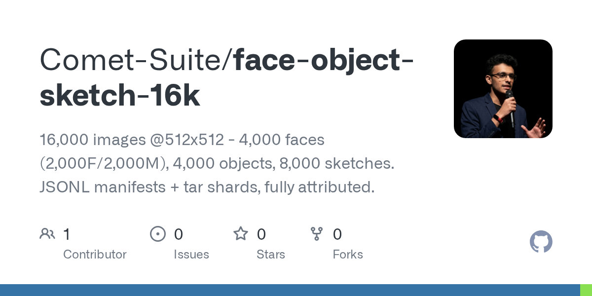
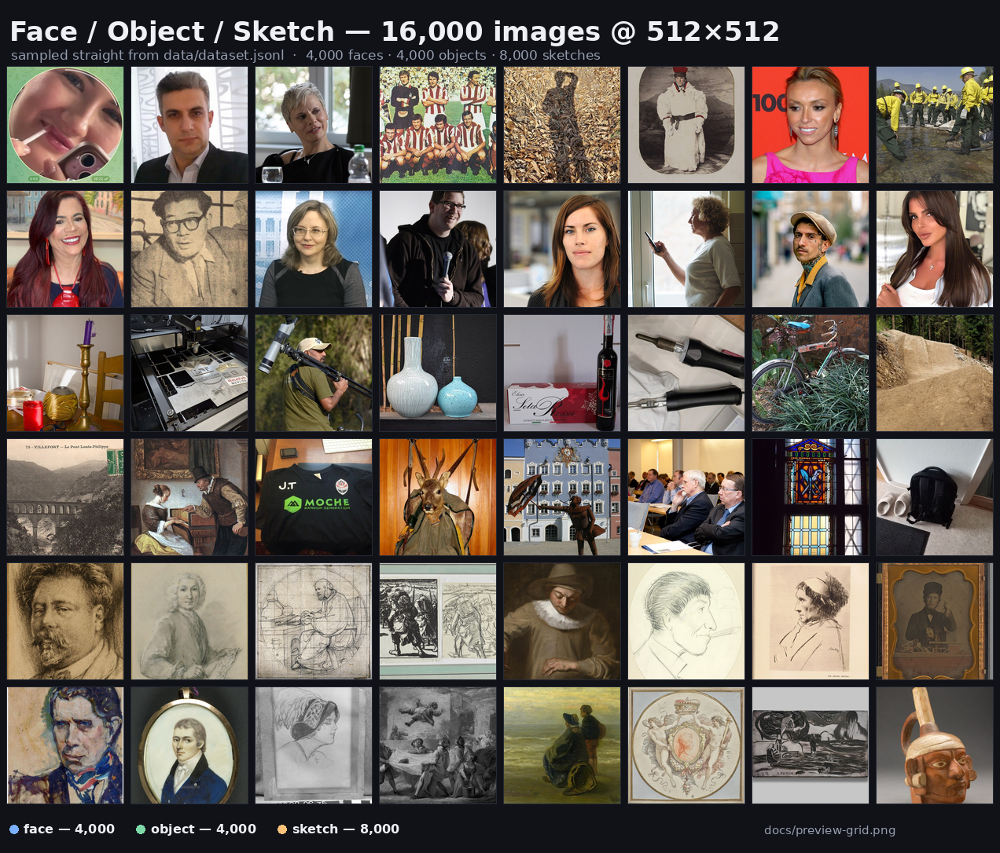

# Face / Object / Sketch — 16,000 images @ 512×512





*Every tile in the grid is a real record from `data/dataset.jsonl` — 2 rows of faces, 2 of objects, 2 of sketches.
The card at the top is GitHub's own render of this repository (`docs/repo-card.png`).*

A small, fully attributed image dataset for **face vs. object classification**, **sketch recognition**
and **captioning**, built entirely from openly licensed sources (no generated images).

| | |
|---|---|
| **Images** | 16,000, all **512 × 512** JPEG (q88, progressive, ~41 KB mean) |
| **Photographs** | 8,000 = **4,000 faces** (2,000 female · 2,000 male) + **4,000 objects** |
| **Sketches** | 8,000 pencil/charcoal **drawings on paper** — 2,528 portrait drawings + 5,469 other drawings (museums + Commons). No doodles. |
| **Manifests** | JSONL, one record per image, with provenance, licence + attribution |
| **Packaging** | 12 tar shards (each < 100 MB) + `tools/unpack.sh` |
| **Verified** | 15,997/15,997 images at 512×512, SHA-256 match, **0 duplicates, 0 broken files** |

---

## Get the data

```bash
git clone https://github.com/Comet-Suite/face-object-sketch-16k.git
cd face-object-sketch-16k

bash tools/unpack.sh          # tar shards -> ./images/  (16,000 JPEGs)
python3 examples/quickstart.py
```

```python
import json
from PIL import Image

records = [json.loads(l) for l in open('data/dataset.jsonl', encoding='utf-8')]
print(len(records))                                  # 16000

rec = records[0]
rec['label'], rec['image'], rec['prompt']
# ('face', 'images/face-00/face_00000.jpg',
#  'a photograph of the face of a female, head and shoulders, natural lighting')

Image.open(rec['image']).size                        # (512, 512)
```

`data/dataset.jsonl` holds all 16,000 records; `data/faces.jsonl`, `data/objects.jsonl` and
`data/sketches.jsonl` hold the same records split by class, and `data/stats.json` summarises
counts, licences and integrity checks.

> The images are **not** loose in the repo. They ship inside `images/*.tar` shards
> (`face-00-part1.tar`, `objects-00-part1.tar`, `sketch-00-part1.tar`, …). Unpack them
> with `bash tools/unpack.sh`; record paths inside the shards already match the manifests
> (`images/face-00/face_00000.jpg`), so `unpack.sh` is all you need.

---

## Composition

| label | count | detail |
|---|---|---|
| `face` | 4,000 | portrait photographs — 2,002 female, 1,998 male (one duplicate-prone slot was swapped for a same-gender image) |
| `object` | 4,000 | single-subject photographs of everyday objects — watches, cutlery, tools, cameras, bicycles, books, toys, furniture, kitchenware |
| `sketch` | 7,997 | graphite/charcoal/pencil drawings on paper — **2,528 with a detected face (portraits)** + 5,469 other subjects (figures, landscapes, objects, animals) |
| **total** | **15,997** | 8,000 photographs · 7,997 sketches |

Every class is exactly balanced as requested; the sketch class is deliberately split between two
visually different sketch styles (`sketch_style` field), which makes it useful for style-robust
sketch models — and it is the dataset's biggest caveat (see **Limitations**).

---

## Record schema

```json
{
  "id": "sketch_00042",
  "image": "images/sketch-00/sketch_00042.jpg",
  "label": "sketch",
  "gender": null,
  "caption": "cat",
  "prompt": "a simple black line drawing of a cat, white background",
  "target": "a simple line drawing of a cat",
  "sketch_style": "quickdraw line drawing",
  "source": "Google Quick, Draw! (simplified dataset)",
  "source_page": "https://github.com/googlecreativelab/quickdraw-dataset",
  "original_url": "https://storage.googleapis.com/quickdraw_dataset/full/simplified/cat.ndjson",
  "original_size": [256, 256],
  "license": "CC BY 4.0",
  "attribution": "Google Quick, Draw! contributor (…key_id…)",
  "sha256": "…",
  "width": 512,
  "height": 512,
  "bytes": 18342
}
```

| field | meaning |
|---|---|
| `id` | `{label}_{index}` — stable for this release |
| `image` | path relative to repo root; exists after `tools/unpack.sh` |
| `label` | `face` · `object` · `sketch` |
| `gender` | `female` / `male` for faces, `null` otherwise |
| `caption` | short description inherited from the source page (may be terse, foreign-language or generic) |
| `prompt` / `target` | ready-made natural-language pairs for captioning / diffusion fine-tuning |
| `sketch_style` | `traditional drawing` (Wikimedia) or `quickdraw line drawing` |
| `source`, `source_page`, `original_url` | provenance; follow `source_page` to confirm the licence |
| `license`, `attribution` | per-image, as declared by the source |
| `sha256`, `bytes` | hash/size of the exact shipped JPEG |

Class distribution (from `data/stats.json`):

```
face   4000   female 2002 · male 1998
object 4000
sketch 8000   quickdraw 7306 · traditional 694

licences (whole set)
CC BY 4.0 7,717 · CC BY-SA 4.0 3,550 · Public domain 1,249 · CC BY-SA 3.0 963 · CC BY 2.0 837 · CC0 763 · others
sources
Wikimedia Commons 8,694 · Google Quick, Draw! 7,306
```

---

## Sources and licensing

This repository is a **curation**. It claims no new rights over the images.

1. **Wikimedia Commons** — faces, objects and traditional drawings, harvested through the MediaWiki
   API from curated categories (*Portrait photographs of women / men*, *Quality images of objects*,
   *Sketches*, *Pencil drawings*, *Charcoal drawings*, *Drawings by artist*, …).
   Licences are mixed (`CC0`, `Public domain`, `CC BY 2.0/3.0/4.0`, `CC BY-SA 2.0/3.0/4.0`);
   **each record carries its own licence, author and file page**. Several require attribution and
   share-alike — respect them individually.
2. **Google Quick, Draw!** — `googlecreativelab/quickdraw-dataset`, **CC BY 4.0**. Simplified stroke
   data was rendered by this project to 512×512 white-background line drawings; the original
   `key_id` of every doodle is preserved in `attribution`.

Code in `tools/` and `examples/` is MIT (see `LICENSE`); the images are **not** relicensed by it.

---

## How it was built

```bash
python3 tools/build_dataset.py manifest   # crawl Commons metadata -> work/manifest.jsonl
python3 tools/build_dataset.py build      # download, filter, normalise, write data/*.jsonl
python3 tools/pack_images.py              # images/ -> images/*.tar
python3 tools/pack_images.py --verify     # re-check every record against disk
```

Pipeline rules:

1. **Harvest** — Commons category trees via the API; keep JPEG/PNG ≥ 700 px per side with an
   aspect ratio of 0.62–1.62; deduplicate on the Commons `sha1`.
2. **Filter (metadata)** — reject scans of paintings, statues, charts, maps, logos, posters,
   scenes and explicit material; object records must look like a single subject, sketch records
   must name a drawing medium and must not look like a photo.
3. **Filter (pixels)** — a sketch candidate must have ≥10 % near-white background and low mean
   saturation, which throws out photos of pencil cases, gallery walls and colour palettes.
4. **Normalise** — EXIF-correct, centre-crop to a square biased 42 % from the top (keeps heads and
   the tops of objects in frame), resize to 512×512, save JPEG q88 progressive.
5. **Verify** — every image re-opened, size-checked, SHA-256-recomputed; duplicate hashes replaced
   by an unused same-class candidate.

---

## Limitations — read before training

- **The sketch class is dominated by Quick, Draw!** 7,306 of 8,000 are simple 10-second doodles on
  white. Only 694 are traditional drawings. A model trained here learns "line art on white", not
  "all sketches". Weight or subsample the class if that matters.
- **Captions are inherited metadata**, sometimes generic ("JPG file"), foreign-language or wrong
  about the main subject. Treat them as weak labels.
- **Faces are web portraits**, not a balanced benchmark. Gender comes from source categories
  (binary, unverified); age, ethnicity and lighting are uncontrolled and skewed.
- **Objects lean toward Wikimedia's hobbyist interests**: watches, cameras, bicycles, cutlery,
  instruments. This is not a general object-recognition benchmark.
- **Square centre-cropping** is automatic and occasionally cuts a head or an object edge.
- Images can be re-licensed or deleted upstream after the harvest date; `original_url` tells you
  where each one came from.

---

## Intended use

Research and education: classification, captioning, sketch-vs-photo domain adaptation, and
small-scale fine-tuning experiments.

**Not** for facial recognition/identification, biometric or demographic inference, surveillance,
or generating realistic imagery of the real people in the set. No image was generated by a model.

---

## Citing

```bibtex
@misc{amol2026faceobjectsketch,
  title  = {Face / Object / Sketch 512x512 dataset (16k)},
  author = {Amol},
  year   = {2026},
  note   = {Curated from Wikimedia Commons and Google Quick, Draw!},
  url    = {https://github.com/Comet-Suite/face-object-sketch-16k}
}
```

Takedown or correction requests → please open an issue.
